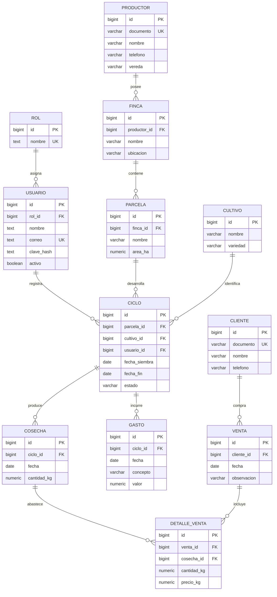

# AgroTrack · arquitectura y modelo relacional

Estado: primera implementación académica con datos ficticios. La identificación y caracterización de la comunidad real de San Jacinto siguen pendientes.

## Arquitectura

El navegador presenta HTML y CSS adaptable. Flask recibe formularios, valida los datos, comprueba el rol, controla la sesión y ejecuta SQL parametrizado. PostgreSQL almacena los registros y hace cumplir claves, relaciones, restricciones y reglas de existencias. No se requiere un servicio externo ni acceso a Internet durante la demostración una vez instaladas las dependencias.

El administrador puede insertar, consultar, actualizar, eliminar y exportar. La cuenta de consulta puede leer, filtrar y exportar. Las rutas de escritura comprueban el rol en el servidor; ocultar botones no constituye el control de autorización. Las consultas se ejecutan en transacciones de solo lectura. El usuario técnico de PostgreSQL no puede crear tablas ni administrar roles.

## Diagrama entidad-relación

Se utilizan 12 tablas, todas conectadas mediante relaciones. Un productor puede tener varias fincas; una finca, varias parcelas; una parcela, varios ciclos históricos. Cada ciclo corresponde a un cultivo y conserva el usuario que lo registró. Una venta contiene detalles que identifican la cosecha de origen. Una misma cosecha puede distribuirse entre varios detalles, sin superar su cantidad.

## Normalización propuesta hasta tercera forma normal

Primera forma normal: cada columna representa un valor atómico en el contexto de la aplicación y no se almacenan listas de cultivos, cosechas ni productos en una celda. Los productos vendidos se representan con filas de detalle_venta.

Segunda forma normal: cada entidad tiene clave primaria. Los atributos no clave describen la entidad completa. En detalle_venta, la combinación alternativa venta_id/cosecha_id es única; cantidad_kg y precio_kg corresponden a esa participación de la cosecha en la venta. No se guardan el nombre del cliente o los datos del cultivo como parte de ese detalle.

Tercera forma normal: los datos del productor se guardan en productor, no en cada finca ni en cada cosecha. La ubicación de la finca no se repite en parcela. Los datos del cultivo no se repiten en ciclo. El nombre del rol no se copia en usuario. Los nombres de las entidades relacionadas se obtienen mediante consultas.

Ingresos, existencias y saldo son valores derivados calculados con funciones y vistas. No se mantienen columnas independientes de total_venta, stock_disponible o saldo que puedan desactualizarse al editar los movimientos.

Supuestos del alcance: una finca tiene un productor responsable; una parcela se dedica como máximo a un ciclo activo; todas las cosechas y ventas se expresan en kilogramos y COP. No se modelan copropiedad, cultivos asociados, pérdidas, devoluciones, impuestos ni cuentas por cobrar. Estos supuestos deben validarse con la comunidad antes de presentar la solución como adoptada.

## Integridad y fiabilidad

- Claves foráneas con ON DELETE RESTRICT protegen el historial; una eliminación dependiente se rechaza.
- UNIQUE protege documentos, catálogo de cultivo/variedad y nombres dentro de su entidad superior.
- CHECK exige cantidades, superficies y precios positivos, además de fechas de cierre coherentes.
- Un índice único parcial permite solo un ciclo activo por parcela.
- Un trigger bloquea la fila de cosecha al vender y verifica la disponibilidad. Otro impide reducir una cosecha por debajo de lo vendido.
- Cada modificación se ejecuta en una transacción y se revierte si falla una regla.
- Las contraseñas se almacenan con hash; las consultas usan parámetros; los formularios incluyen token CSRF.

## Funciones, consultas y extracción

fn_ingresos_ciclo recibe un identificador y calcula ingresos de los detalles vinculados a las cosechas de ese ciclo, redondeando cada importe a dos decimales de COP antes de sumarlo. v_existencias muestra kilos cosechados menos kilos vendidos. v_resumen_ciclos reúne productor, finca, parcela y cultivo y calcula producción, ingresos, gastos y saldo.

El reporte aplica filtros combinables de productor, cultivo, estado y fechas de siembra. Incluye una subconsulta que cuenta los ciclos seleccionados cuyos ingresos superan el promedio global. Los CSV exportan las filas filtradas y se pueden analizar en una hoja de cálculo. Los filtros de fecha del reporte se refieren al inicio del ciclo y no al período contable de cada movimiento.

El saldo parcial es ventas menos gastos registrados. No equivale automáticamente a rentabilidad o utilidad total, porque no incluye costos omitidos ni valoración del inventario.
